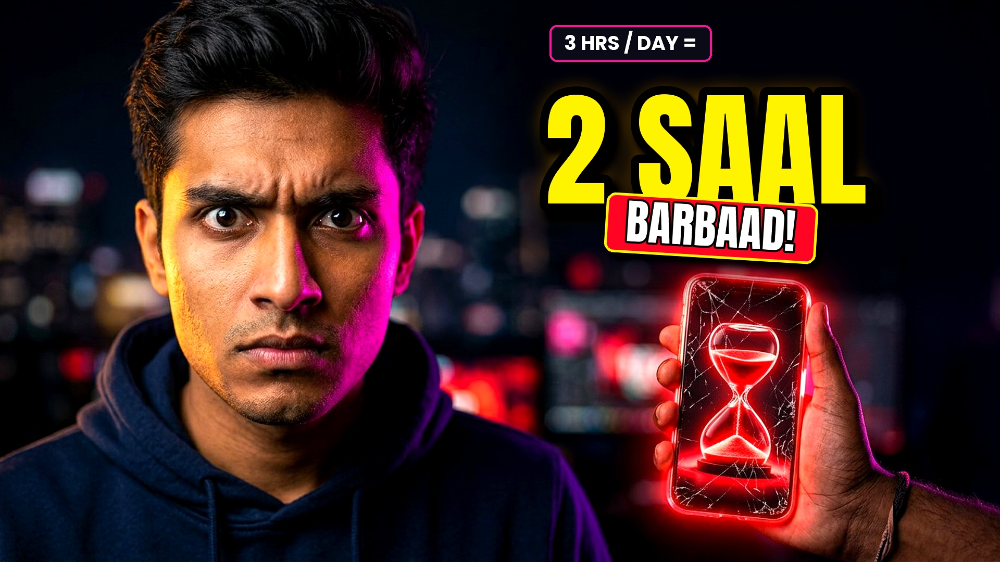
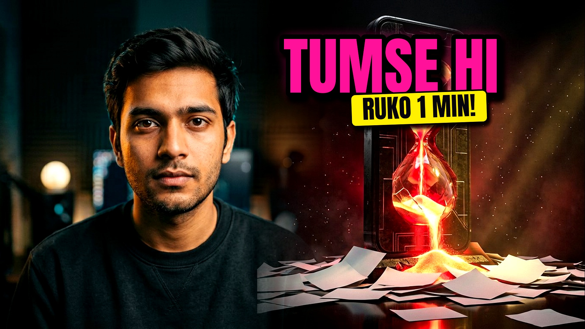
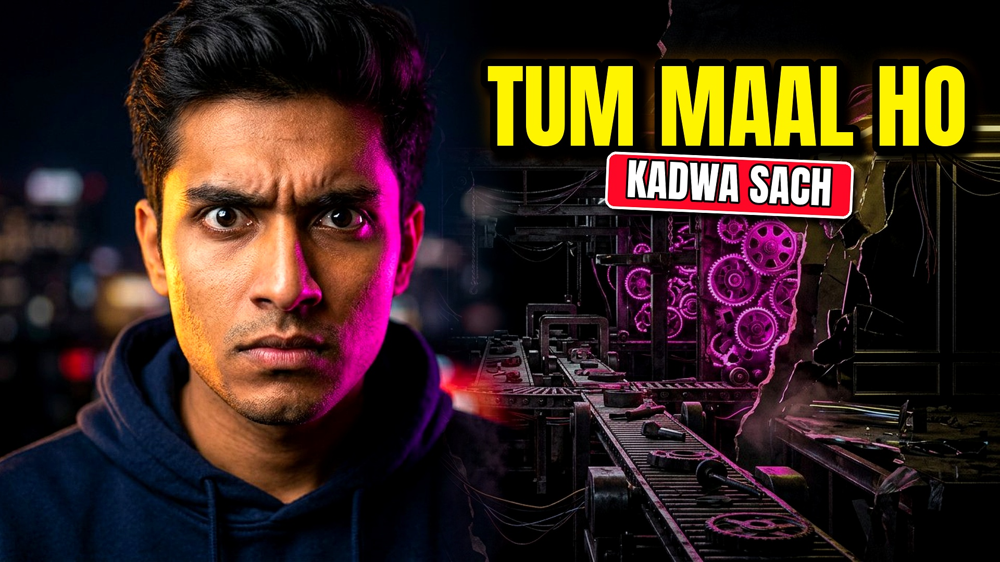

# Aryan Chaudhary Extra — Video #01: *Tum Hi Se Baat Kar Raha Hoon* (10:00 Full HD Master)

### 🎬 [⬇️ CLICK HERE TO DOWNLOAD YOUR 10:00 FULL HD `.MP4` VIDEO (40 MB)](https://github.com/sandhyachaudhary1234567890-ux/youtube-videos/raw/main/videos/Tum_Hi_Se_Baat_Kar_Raha_Hoon_10min_MASTER.mp4)

> **Important GitHub Tip:** Because this Full HD video is `40 MB`, clicking the file inside GitHub's code browser shows *"View raw"* instead of an inline player. **Click the big link above** (or open [`videos/Tum_Hi_Se_Baat_Kar_Raha_Hoon_10min_MASTER.mp4`](videos/Tum_Hi_Se_Baat_Kar_Raha_Hoon_10min_MASTER.mp4) and click **"Download raw file"**) to save & play the `.mp4` directly on your phone or computer!

---

## 📦 Direct One-Click Downloads

| Asset | Spec | One-Click Download |
|---|---|---|
| **1. Ready 10:00 Master Video (`.mp4`)** | `1920×1080` · `24 fps` · H.264 + Stereo AAC (`40 MB`) | [**⬇️ Download `Tum_Hi_Se_Baat_Kar_Raha_Hoon_10min_MASTER.mp4`**](https://github.com/sandhyachaudhary1234567890-ux/youtube-videos/raw/main/videos/Tum_Hi_Se_Baat_Kar_Raha_Hoon_10min_MASTER.mp4) |
| **2. Clean Music + SFX Only (`.m4a`)** | `10:00` Stereo — **Zero AI Voice** (Swap in your own voice!) | [**⬇️ Download `bgm_and_sfx_only_10min.m4a`**](https://github.com/sandhyachaudhary1234567890-ux/youtube-videos/raw/main/videos/audio_stems/bgm_and_sfx_only_10min.m4a) |
| **3. Isolated AI Voice Timing Guide (`.m4a`)** | `10:00` Timed Reference Voiceover | [**⬇️ Download `ai_voiceover_timed_10min.m4a`**](https://github.com/sandhyachaudhary1234567890-ux/youtube-videos/raw/main/videos/audio_stems/ai_voiceover_timed_10min.m4a) |
| **4. Main YouTube Thumbnail (`1920×1080`)** | MrBeast / Dhruv Rathee High-CTR Winner | [**⬇️ Download `01_MRBEAST_2_SAAL_MAIN.jpg`**](https://github.com/sandhyachaudhary1234567890-ux/youtube-videos/raw/main/thumbnails/01_MRBEAST_2_SAAL_MAIN.jpg) |
| **5. Full Written Production Package (`A–G`)** | Scored Hooks, 1,325-Word Script Table, SFX Cues, 5 Shorts | [**📄 Open `docs/MASTER_PRODUCTION_PACKAGE_A_TO_G.md`**](docs/MASTER_PRODUCTION_PACKAGE_A_TO_G.md) |

---

## 🖼️ High-CTR YouTube Thumbnails (`thumbnails/`)

### Option 1 (Recommended Winner): *Tumhari Zindagi Ke 2 Saal Kahan Ja Rahe Hain?*


### Option 2: *Ye Video Tumse Hi Baat Kar Raha Hai (10 Minute Ka Sach)*


### Option 3: *Reels, Fake Courses Aur Tumhara Future: Kadwa Hisaab*


---

## 🎙️ How to Replace the AI Voice With Your Own Voice in 10 Seconds

1. Put on earphones with `videos/audio_stems/ai_voiceover_timed_10min.m4a` (or watch the MP4 on mute) and record your own Hinglish voiceover from [`docs/MASTER_PRODUCTION_PACKAGE_A_TO_G.md`](docs/MASTER_PRODUCTION_PACKAGE_A_TO_G.md).
2. Drop `videos/audio_stems/bgm_and_sfx_only_10min.m4a` under your voice in CapCut / Premiere / DaVinci Resolve — **or** run one command:

```bash
.venv/bin/python scripts/replace_voice.py path/to/your_recorded_voice.wav
```

Outputs `videos/Tum_Hi_Se_Baat_Kar_Raha_Hoon_MY_VOICE.mp4` with automatic EQ, compression, and `-13.5 dB` sidechain music ducking.
